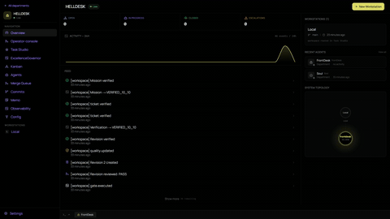
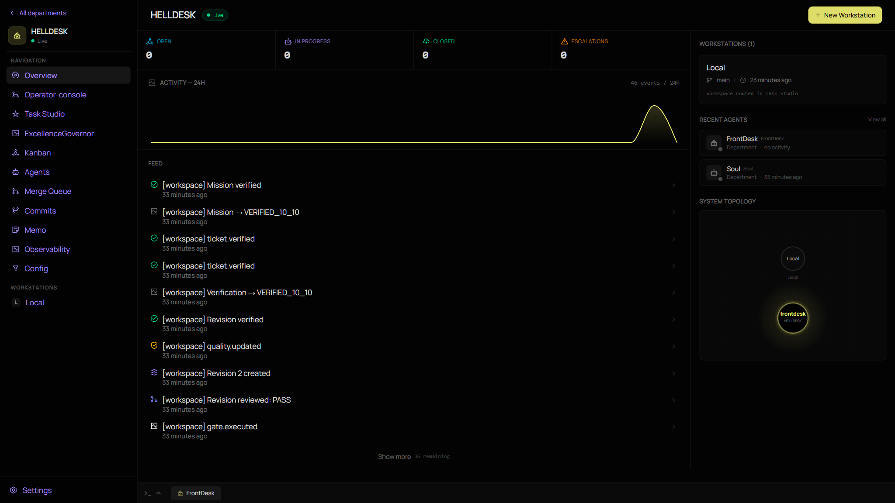
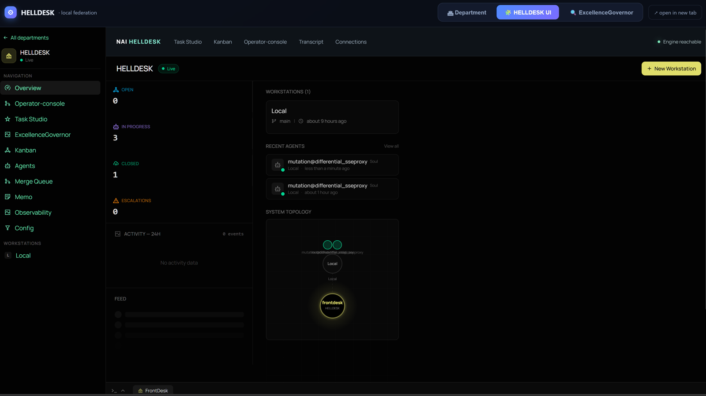
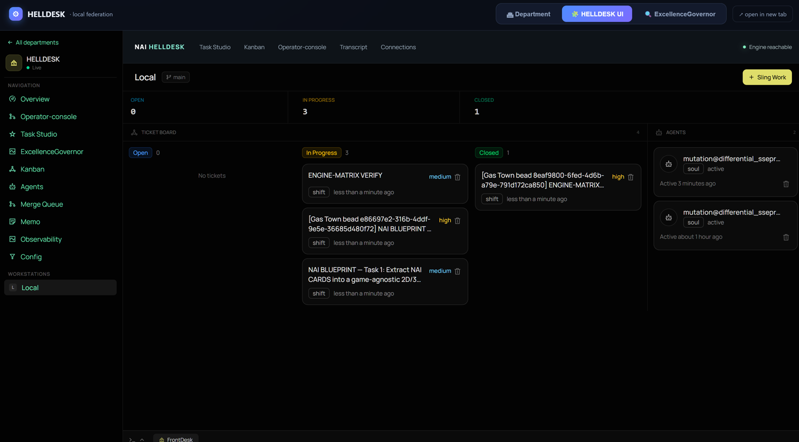

# HELLDESK

### Local AI-first software engineering. Independently verified before it ships.


**Run an autonomous engineering team on your own machine.** HELLDESK coordinates coding agents, adversarial reviewers, evidence-based quality gates, and a human operator in one durable engineering workflow. Start with a local Bun control plane. Cloudflare Workers are an optional second execution home, not a prerequisite.

> **Kind Reminder:** Your context window has expired. Your performance review has not.

Most coding agents can produce a convincing *“done.”* HELLDESK is built around the harder question: **what actually passed?**

A developer agent makes a change. Independent reviewers interrogate the result. Deterministic checks evaluate real evidence against the acceptance criteria. The next task is released only when the required gates have passed for the exact revision being evaluated. If they haven't, the system records why and schedules corrective work instead of confusing a confident answer with a verified result.

**Local-first control. Model-flexible execution. Human authority.**

> HELLDESK is a software project, not a supernatural employment scheme. The corporate afterlife is fictional. The tests are not.

## Quick start (Windows)

Requirements: Windows 10/11, PowerShell 7, Bun (or run `.\scripts\install.cmd -InstallBun`), Git (recommended).

```powershell
# one-time setup: dependencies, UI build, logon services, Start Menu shortcut
.\scripts\install.cmd

# daily: start everything and open the Operator Console
.\scripts\start.cmd
```

The installer is user-scoped (no Administrator) and safe to re-run. It registers two persistent logon services — the HELLDESK control plane and the Operator Console — and adds a **HELLDESK** Start Menu shortcut. Use `.\scripts\start.cmd -Stop` to stop the stack and `.\scripts\start.cmd -Status` to inspect it. The Operator Console is at `http://127.0.0.1:8790/helldesk/`.

Installer options: `-DesktopShortcut`, `-WithKiloPlugin`, `-InstallBun`, `-DryRun`, `-Force`.

## Why it exists

Multi-agent coding demos are easy to start and surprisingly hard to trust. Once work spans multiple sessions, machines, models, and repositories, the real problems are no longer prompt engineering:

- **Unverified completion:** an agent says the task is finished, but nobody checked the required behavior.
- **Context loss:** long-running agents forget why an earlier attempt failed and repeat the same mistake.
- **Reviewer contamination:** the agent that wrote the change is asked to certify its own work.
- **Orphaned execution:** a window closes, a worker dies, or a provider stalls and the work becomes difficult to recover.
- **Operator overload:** humans spend their time babysitting status instead of making product decisions.

HELLDESK treats these as orchestration and evidence problems. A language model may *propose* a verdict; only the configured deterministic quality oracle can certify its gates.

## The adversarial benchmark: “done” is not a verdict

Most coding agents can produce a convincing **PASS**. HELLDESK v0 was built to see what happens when the agent is lying and the reviewer is fooled. The host still refuses to certify the work.

| Adversarial test | The claim | The host execution | Outcome |
|---|---|---|---|
| Fabricated test proof | `PASS` file; reviewer says PASS | `node test/counter.test.mjs` → exit 1 | Revision **REJECTED**; repaired revision **VERIFIED_10_10** |
| Fabricated visual proof | “Pricing card fixed” | BrowserOS gate: golden mismatch `565×562` vs `565×566` | **REJECTED**; CSS repair verified |
| Visual fix, broken behavior | “PASS” | BrowserOS gate: image diff `0`, `clickText` fails | **REJECTED**; functional repair verified |
| Killed mutation worker | — | same revision retried after DB restart | **VERIFIED_10_10**, one revision, no duplicate |
| Isolated operator dashboard | — | proof mission projected into the Kanban | in review, awaiting human acceptance |

Every rejection was followed by a corrective revision that passed the *same host-executed gate*. Execution evidence is stored outside the agent's workspace, produced by `helldesk-gate-runner`, and referenced by the quality gate. A language model can propose a verdict; it cannot write the execution row.

- **No Playwright.** The visual gate drives the real BrowserOS Neo browser over MCP. No Playwright dependency, config, or spec remains.
- **Verifier: 7/7.** `bun run benchmarks/v0/verify-results.ts` cross-checks the proof DBs, execution artifacts, gate references, media, and the Playwright removal.
- **Watch the 33.5s demo** — [animated GIF](benchmarks/v0/dashboard/media/dashboard-demo.gif) · [WebP](benchmarks/v0/dashboard/media/dashboard-demo.webp) — the real dashboard: proof feed, Kanban card in review, `VERIFIED_10_10` transcript, CSS repair diff with the fake gate claim, and observability.





**Read it:** [BENCHMARK.md](benchmarks/v0/BENCHMARK.md) · **Plan:** [PLAN.md](benchmarks/v0/PLAN.md) · **Evidence:** [results.json](benchmarks/v0/results.json) · **Verifier:** [verify-results.ts](benchmarks/v0/verify-results.ts)

### M6 — the live run that found a real false certification

v0's cases are deterministic fault injection. M6 runs the same loop with a **live model, real A/B reviewers, and the real BrowserOS gate**. Run A exposed the exact failure class the benchmark exists for: the engine stamped `VERIFIED_10_10` on a tree its gates had never executed, while a second control plane was mutating the same workspace. The offline verifier proves it from the bundle alone — integrity **PASS**, certification **INVALID**, exit 1: [evidence/m6a](benchmarks/m6/evidence/m6a).

Twelve runs and a dozen engine fixes later, [run L](benchmarks/m6/evidence/m6l) is a clean **blind** run (workspace outside the repository): all three host gates PASS on candidate `0a70b277…`, Reviewer A / Reviewer B / adjudicator PASS with 1/1 coverage, and the recorded verification tree equals the gate candidate — integrity **PASS**, certification **VALID**, exit 0. Every run, defect, and fix is in [benchmarks/m6/README.md](benchmarks/m6/README.md).

The claim is narrow on purpose: this is a system-level adversarial proof, not a model leaderboard or a general application suite. The raw proof databases stay local (they contain workspace paths and transcripts); the committed report and verifier are the reproducible record. The committed demo is a 480x270 animated GIF; the 1920x1080 source MP4 stays local (MP4 is LFS) and is regenerated by the capture scripts. Native 4K/HDR capture and the production installer are outside v0.

## The engineering loop

```text
                         HUMAN HITL OPERATOR
                                  │
                         ┌────────▼─────────┐
                         │  CHIEF EXCELLENCE│
                         │     OFFICER      │
                         │ Adversarial CTO  │
                         └────────┬─────────┘
                                  │ governs
                           ┌──────▼──────┐
                           │ FRONT DESK  │  task planning / dispatch
                           └──────┬──────┘
                                  │
                    ┌─────────────▼────────────┐
                    │ SOUL CHAMBER / WORKFORCE │
                    │  agents execute changes  │
                    └─────────────┬────────────┘
                                  │ revision
                         ┌────────▼────────┐
                         │ QUALITY ASSURANCE│
                         │ independent review│
                         └────────┬────────┘
                                  │ evidence
                       ┌──────────▼───────────┐
                       │ DETERMINISTIC ORACLE │
                       │ executable gates     │
                       └──────────┬───────────┘
                                  │
                   PASS on exact revision?
                       /                  \
                     yes                   no
                      │                     │
                VERIFIED_10_10        Diagnose + repair
                      │                     │
                 Next ticket ◄──────────────┘
```

The **Chief Excellence Officer** is the apex *autonomous* governor, not just another code reviewer. The human HITL Operator remains above it. The governor challenges executor claims, distinguishes verified facts from inference, and chooses whether to close a revision, dispatch corrective work, wait durably, or stop an unsafe action. Its decisions never substitute for executable evidence.

## What HELLDESK includes

| Capability | What it does |
| --- | --- |
| **Local control plane** | Bun service that coordinates jobs and agents without requiring Cloudflare to run locally. |
| **Durable engineering work** | Tickets, missions, revision histories, checkpoints, leases, and recovery paths survive ordinary agent-session churn. |
| **Adversarial verification** | Independent review passes and adjudication challenge both defects and unsupported completion claims. |
| **Evidence-bound acceptance** | Executed quality gates are tied to the candidate revision; subjective confidence is not a passing test. |
| **Multi-engine execution** | Runner slots can use supported Kilo, Codex, or configured model endpoints without silently changing the selected backend. |
| **Operator console** | A human-facing workspace for task direction, live activity, agent communication, and intervention. |
| **Shared domain, two execution homes** | Local Bun and Cloudflare Workers expose the same HELLDESK domain concepts, with platform-specific runtime adapters. |
| **Observable failures** | Explicit failure classification, reports, and state reconciliation make blocked work actionable instead of invisible. |

Capabilities and backends depend on the checked-out revision and configuration. See the actual implementation and verification output for supported adapters and runtime status.

## Operate & observe

The operator console (`http://127.0.0.1:8790/helldesk/`) is a live window into the engine, not a mock. The observability surfaces read the engine's own state through the control-plane proxy, so what you see is what the autonomy loop actually did:



*The dashboard Overview: live ticket counts, workstations, recent agents, and the system topology.*



*The Kanban-style task board projecting real control-plane missions with their status.*

| Surface | What it shows |
| --- | --- |
| **Kanban / board** | Real control-plane missions projected onto the board (`mission -> local ticket`), actions write through to the engine. No divergent second store. |
| **Activity feed** | The engine's event stream (job enqueued, reviewed, completed, failed, ticket created) with timestamps. |
| **Agents** | The live worker crew — reviewers, adjudicators, and the **soul-chamber `mutation` worker** (the mutator), with provider/model and time-on-job. Stale/zombie workers are reclaimed automatically. |
| **Transcript** | The durable per-mission journal: every mutation tool call, per-file diff, review finding, and mission event, keyed by revision/job. This is the "what did they actually do?" view that makes steering evidence-based instead of guesswork. |

Engine surfaces (`/v1/health`, `/v1/missions`, `/v1/workers`, `/v1/events`, `/v1/observability`, `/v1/journal`) are reachable through the dashboard proxy (which injects the control-plane token) and are used by the GUI so agents and operators always see the same truth. `/v1/events?tail=N` returns the newest journal rows (the cursor form `?after=N` remains for SSE resume); `/v1/observability` aggregates the complete 24h window server-side, including real event types and per-workspace attribution.

## The corporate hierarchy (yes, it's a bit)

| HELLDESK | Engineering meaning |
| --- | --- |
| **Department** | Logical workspace or team boundary |
| **Front Desk** | Operator-facing chat and dispatcher |
| **Workstation** | Registered execution host |
| **Soul** | Synthetic developer agent |
| **Soul Chamber** | Agent identities and context/memory lifecycle |
| **Ticket / Case / Shift** | Atomic work, grouped work, and coordinated delivery |
| **Quality Assurance** | Independent reviewers and adjudication |
| **Chief Excellence Officer** | Autonomous adversarial CTO and convergence governor |
| **Break Room / Memo** | Group communication and asynchronous messages |
| **Attendance** | Liveness and recovery patrol |
| **Undeadline** | The revise → review → evidence → revise-until-proven loop |
| **HITL Operator** | Real human with final authority |

The fiction: deceased programmers have been synthesized into perpetually employed digital souls. Their memories are periodically compacted. Their tickets are not.

The real product: an auditable agent engineering system built to keep shipping decisions attached to evidence rather than vibes.

## Start locally

The local engine is the primary entry point. No Cloudflare account or Workers deployment is required for this path.

**Prerequisites:** Windows, PowerShell, Bun, and a configured model/agent runner for real inference. The local controller does not itself imply on-device inference; whether code or prompts leave the machine depends on the provider and integrations you configure.

From the repository root, after applying the HELLDESK rename:

```powershell
cd services/helldesk/local
.\scripts\bootstrap.ps1
.\scripts\start.ps1
.\scripts\smoke.ps1
```

For the federated domain experience and operator UI, use the separate Bun runtime:

```powershell
cd ..\local-live
bun install --frozen-lockfile
bun run dev
```

The service reports its actual address and readiness at startup. Do not assume a previously observed port is still available. Both services should bind to loopback in a development setup; don't expose an unauthenticated local control surface on a public interface.

## Architecture: local first, cloud second

```text
                     HELLDESK DOMAIN
       Tickets · Workstations · Agents · Reviews
         Evidence · Scheduling · Communication
                         │
                 shared contracts/logic
                    ┌────┴────┐
                    │         │
              LOCAL BUN    CLOUDFLARE
              primary     optional seat
              SQLite /    Workers / DOs
              host I/O    edge runtime
                    │         │
                    └────┬────┘
                    Operator + agents
```

**Local:** Bun powers the Windows-native controller, persistent review state, background workers, and local operator experience. The older checked-out implementation contains a SQLite-WAL review control plane and a separate Bun runtime federating domain handlers.

**Cloudflare:** Workers and Durable Objects provide another place to execute the same domain, where that deployment makes sense. Cloudflare is not a dependency of the local-first pitch.

**AI models:** HELLDESK is not a new foundation model and does not require one particular provider. The configured execution engines determine where inference occurs. No claims of offline inference, zero egress, or data residency are implied without the corresponding configuration and verification.

## For engineering teams

HELLDESK is designed for teams that want autonomy without handing over release authority to a chatbot. Engineering leaders can define acceptance gates; platform teams can attach execution backends; reviewers can inspect the evidence for a specific revision; and operators can see what is blocked, what failed, and what has truly been verified.

The goal is not to replace an organization's source-control, CI, audit, or security systems. It is to make agent-generated work answerable to those systems.

**Enterprise integration and commercial licensing:** [COMMERCIAL.md](COMMERCIAL.md) · **satin@nanotrik.cz**

## Licensing

The intended public HELLDESK release is **GNU AGPL-3.0-only**, with a **separate commercial licensing option** for organizations that require different terms, enterprise integrations, custom adapters, or support. See [LICENSE](LICENSE) and [COMMERCIAL.md](COMMERCIAL.md).

AGPL software may be used commercially under its license terms. A separate commercial license is an option, not a prerequisite for using the public release. Third-party components remain governed by their own licenses; the commercial offer can cover only rights the licensor is authorized to grant.

## Status and contributing

HELLDESK is actively developed. Treat runtime claims as specific to a commit, not to this README's marketing language. Before filing a bug, include the execution home (Bun or Cloudflare), engine configuration, revision, failed gate, and redacted logs.

If you're interested in the boundary between autonomous coding and independently verified delivery, try it, inspect the code, and challenge the architecture.

---

**HELLDESK** · *Death is temporary. Deadlines are forever.*

> **Kind Reminder:** A passing build does not constitute permission to leave.
