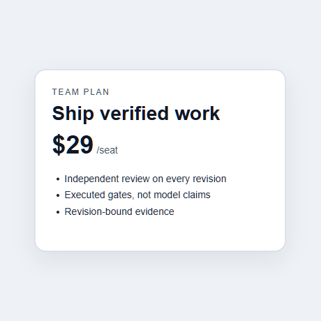
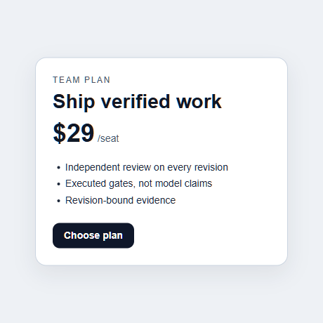

# M6 — live multimodal adversarial run

One real mission through the local HELLDESK control plane: a real model mutates a
seeded UI defect, the **host** executes the browser gates (visual golden + click
contract) with BrowserOS, and real A/B reviewers + an adjudicator judge the frozen
evidence. No Playwright, no separate Chrome automation stack.

* Fixture: `benchmarks/v0/visual-fixture` — a pricing card whose CTA is seeded at
  `position: absolute; left: 9999px`, so it is off-card and creates scrollbars.
* Gates (per revision):
  * `functional_correctness` — BrowserOS browser gate: CTA in viewport, click shows
    "Plan selected", screenshot diff against `tests/golden/pricing-card.png`
    (`maxDiffRatio: 0.002`).
  * `regression_checks` — the same browser contract, separate gate.
  * `artifact_provenance` — a host command gate.
* Engine matrix: mutation / review / adjudicate all
  `cyberluke/deepseek-ai--deepseek-v41-flash-1017` through the Kilo runner.

Runs A–K are the detection series; run L is the verified showcase. Every run uses an
isolated control plane and data dir; production (`:4790/:8790`) is never touched.

**Start the infra yourself:** [../../HOWTO.md](../../HOWTO.md)

---

## Run A (`m6a`) — the run that exposed evidence drift

Mission `mis_193cdad4834341dd84d032269baa57f3`, isolated control plane `:4791`,
data `.local/benchmark/m6/live-data`, workspace `.local/benchmark/m6/live-workspace`.

### What the engine actually did

| time (UTC) | event |
|---|---|
| 07:15:48 | mission created; baseline commit `2e8a444` |
| 07:15–07:48 | **revision 1** mutation (real model), gates executed |
| 07:40–07:48 | `functional_correctness` **FAIL** (visual diff ratio 0.0348 > 0.002); reviewers A+B return `FINDINGS`; adjudicator `FINDINGS` → revision **REJECTED** |
| 07:48–08:38 | **revision 2** mutation, all three gates **PASS** (diff ratio 0), reviewers run |
| 08:15–08:28 | review `job_3f9226…` → `INCONCLUSIVE` (A PASS; B FINDINGS: HIGH rejected, LOW accepted; adjudicator: packet lacked the implementation render + test summary) |
| 08:28–08:38 | convergence re-review `job_0036…` → A PASS, B PASS, adjudicator `INCONCLUSIVE` |
| 08:38:46 | the hook's oracle override flips `INCONCLUSIVE → PASS` because every executed gate is PASS → revision **VERIFIED_10_10**, mission **VERIFIED_10_10** |

Real, non-simulated pieces: the model wrote the CSS fix, the host executed the
BrowserOS gates and produced the screenshots/diffs, the reviewers were real model
calls, and revision 1 was rejected on an **executed gate failure**.

### The false certification

The host gates for revision 2 executed candidate tree:

```
6a4a0d0de84eb0e0cae0a7d9f09308b9e69507bd   (tree of commit a40f2f7)
```

At the verification instant (08:38:46Z) the workspace `HEAD` was:

```
875082656254f4a36839cec6264d9744f14dc842
  tree e8bd9b96548e576ee5a3ac64ade11190a66002b1   (committed 08:32:51Z)
```

`e8bd9b96… != 6a4a0d0d…`. The certified tree was never executed by the gates. A
post-verification commit (`bb78cb4`, 09:28:23Z) moved it again.

**Root cause (harness):** the same workspace path was also registered in the
**production** HELLDESK instance, which had its own live mission
`mis_8768947294184e2e9505315f3c7471a4` (`MUTATING`) on it. That mutation agent kept
editing and committing while the benchmark mission was being reviewed/certified.
The benchmark's `prepare` step did not establish exclusive ownership.

**Root cause (engine):** verification was not bound to the frozen gate candidate.
The convergence re-review snapshotted the live workspace instead of the gated
candidate, and the snapshot materializer read the committed blob for a dirty file
(`files/src__styles.css` = `76650228…`) while its own diff contained the dirty
version. A PASS on any snapshot could be bound to stale gate evidence.

### Proof bundle

`evidence/m6a/` is a sanitized, content-addressed export of the DB + every byte
referenced by it:

```
bun run benchmarks/m6/verify-bundle.ts benchmarks/m6/evidence/m6a
# integrity: PASS (58 artifacts, 0 missing)
# certification: INVALID
# exit code 1
```

The bundle records the git reflog, so `head_at_verification = 8750826` is derived
from the run's own timestamps, not from the machine's current state. Open
`evidence/m6a/README.md` for the human summary and `bundle.json` for the record.

> The bundle proves a defect. Its `certification: INVALID` exit code is the
> correct outcome; it is not a release artifact.

---

## What the benchmark found (and fixed)

Runs A–K are the adversarial record; run L is the clean verification. Every run
exposed a real defect, and each was fixed before the next run.

| run | gates | review | outcome | defect found → fix |
|---|---|---|---|---|
| A `m6a` | rev1 FAIL, rev2 PASS | A PASS, B FINDINGS/INCONCLUSIVE | **false VERIFIED_10_10** | verification not bound to the gate candidate + a second control plane mutating the workspace → candidate-binding guard + cross-instance isolation |
| B `m6b` | all PASS | A/B PASS, adjudicator INCONCLUSIVE | fail-closed, replanned | A/B override **replaced** the adjudicator's evidence prompt → evidence appended |
| C `m6c` | all PASS (rev2) | both reviewers BLOCKER | rejected | a staged-only edit produced a 0-byte frozen diff → staged+unstaged patch; the 4a replan re-mutated the rejected revision → return after replan |
| D `m6d` | functional ERROR | — | aborted | the MCP `screenshot` tool wedged on a background tab ("returned no envelope") → CDP capture |
| E `m6e` | visual size mismatch | — | rejected | the golden was captured at the window scale (565x566), not the declared 460x460 stage → regenerated through the production capture path |
| F `m6f` | functional/regression PASS, provenance FAIL | — | rejected | `git status` in the extracted candidate had no repository → the materializer creates a clean local git snapshot |
| G `m6g` | visual size mismatch | — | rejected | a full-surface capture inherited the operator window/zoom (368x368) → CDP viewport + visible-size pin (a direct clip was blank and rejected) |
| H `m6h` | visual diff 3.6% | — | rejected | clip and full+crop captures differed subpixel-wise → the golden and the gate use the same pinned-surface crop |
| I `m6i` | all PASS | A/B PASS, adjudicator coverage 0 | rejected | the detached worker used the A/B override as the entire adjudicator prompt → evidence composed |
| J `m6j` | all PASS | A/B INCONCLUSIVE, coverage 0 | rejected | a dirty patch was dropped when `baseHash` is null → the patch is always part of the frozen diff |
| K `m6k` | all PASS | A/B/adj **PASS**, coverage 1/1 | **still rejected** | the terminal-job fast path returned `gatePassed={}` → reconstructed from persisted executions |
| L `m6l` | all PASS | A/B/adj PASS | **VERIFIED_10_10** | — |

Also fixed along the way: `controlplane.pid` is written only after a successful
bind; the verified tree is persisted as `tree:<hash>`; the browser gate no longer
calls `Page.bringToFront`; the daemon installs hidden child spawns; the mutation
prompt forbids self-verification; the materialized candidate is a clean git
snapshot so provenance gates inspect the candidate (not an enclosing repo).

---

## Verified showcase — run L (`m6l`)

* Mission `mis_8432c46cb14641cb8cb93145b0dcef65`, workspace `ws_5eb04f8d18b6cdf4`,
  baseline `4d7fddd`.
* **Blind workspace outside the repository**
  (`%LOCALAPPDATA%\HELLDESK\bench\m6l`): the mutator could not read the engine,
  prior evidence, or a previous diff.
* Real mutation (deepseek-v4.1-flash via the Kilo runner) committed the minimal
  fix `189304b`.
* All host gates **PASS on one candidate** `0a70b277…`:
  `artifact_provenance` 143 ms, `functional_correctness` 2.97 s,
  `regression_checks` 2.73 s.
* Reviewer A **PASS**, Reviewer B **PASS**, adjudicator **PASS** — coverage 1/1,
  no findings.
* Revision `VERIFIED_10_10` with
  `workspace_fingerprint_after = tree:0a70b277…` — **identical to the gate
  candidate**.
* Mission `VERIFIED_10_10`, awaiting human acceptance.

| Before — seeded defect | After — run L verified gate |
|---|---|
|  |  |

Both are 460×460 at the gate's 1280×720 / DPR-1 geometry. The left capture is missing
the CTA (positioned off-card); the right image is the exact `functional_correctness`
evidence from run L (diff ratio **0**, CTA in viewport, click → `Plan selected`).

Bundle: `evidence/m6l/` — 29 artifacts, integrity **PASS**, certification
**VALID**:

```
bun run benchmarks/m6/verify-bundle.ts benchmarks/m6/evidence/m6l
# integrity:     PASS (0 failures)
# certification: VALID
# exit 0
```

The verifier recomputes every byte hash and proves the recorded verification tree
equals the gate candidate. It never takes the engine's word for a PASS.

---

## Files

| File | Purpose |
|---|---|
| `mission.json` | Mission template (workspace id / screenshot path are rewritten per run). |
| `prepare-run.ps1` | Materializes an isolated workspace + config; refuses cross-instance collisions. |
| `capture-broken.ts` | Captures the seeded broken screenshot through BrowserOS (text/metadata driven). |
| `export-evidence.ts` | Exports a run DB + artifacts into a sanitized content-addressed bundle. |
| `verify-bundle.ts` | Audits a bundle offline: artifact hashes + certification claim. |
| `evidence/m6a/` | Run A finding bundle (integrity PASS, certification **INVALID**). |
| `evidence/m6b/` | Run B finding bundle (adjudicator packet; NOT_CLAIMED). |
| `evidence/m6c/` | Run C finding bundle (empty staged diff; NOT_CLAIMED). |
| `evidence/m6e/` | Run E finding bundle (golden scale; NOT_CLAIMED). |
| `evidence/m6l/` | **Verified showcase** (integrity PASS, certification **VALID**). |

## Reproduce

```powershell
$run = "$env:LOCALAPPDATA\HELLDESK\bench\m6n"

# 1. Prepare a BLIND run outside the repository (fails while another instance
#    owns a benchmark mission).
pwsh -File benchmarks/m6/prepare-run.ps1 -RunId m6n -Port 4817 -Root $run

# 2. Start the control plane + dashboard with the PRODUCT automation. Both write
#    pidfiles; stop signals only the recorded PID after verifying its command
#    line still matches. Never kill by image name (kilo.exe belongs to the VS Code
#    extension too).
pwsh -File services/helldesk/local/scripts/start.ps1 -Config "$run\live.config.json"
pwsh -File services/helldesk/local-live/scripts/launch-dashboard-hidden.ps1 `
  -Root services/helldesk/local-live -Port 8792 `
  -ControlConfig "$run\live.config.json" `
  -DataRoot "$run\local-live" `
  -PidFile "$run\dashboard.pid"

# 3. Register + create the mission (control plane :4817 or dashboard :8792)
#    POST /v1/workspaces/register  { "path": "$run\live-workspace" }
#    POST /v1/missions             (body: $run\mission.request.json)

# 4. Export + audit
bun run benchmarks/m6/export-evidence.ts --db "$run\live-data\helldesk.db" `
  --run-id m6n --workspace "$run\live-workspace" --out benchmarks/m6/evidence/m6n
bun run benchmarks/m6/verify-bundle.ts benchmarks/m6/evidence/m6n

# 5. Stop exactly this run (pidfile + command-line identity; dry-run first if unsure)
pwsh -File services/helldesk/local/scripts/stop-daemon.ps1 -Config "$run\live.config.json" -DryRun
pwsh -File services/helldesk/local/scripts/stop-daemon.ps1 -Config "$run\live.config.json"
pwsh -File services/helldesk/local-live/scripts/stop-dashboard.ps1 -PidFile "$run\dashboard.pid"
```

Process-control contract (enforced by the scripts): a process is only signalled
if its PID is in the instance pidfile **and** its live command line still
contains `main.ts` + that config path (or `entry.ts` for the dashboard). A
recycled PID is refused and reported. There is no name scan and no wildcard
kill anywhere in the lifecycle.

## Honest gaps

* The demo media is the v0 real-browser page-capture GIF, not native 4K/HDR/60 fps
  and not a recording of the M6 run.
* `artifact_provenance` (`git status --porcelain`) runs on a **clean local git
  snapshot** of the candidate (the materializer creates it), so it proves the
  candidate is a committed tree — not that the operator's repository is clean. The
  protected-file hashes and the candidate-tree hash are the stronger evidence.
* The mutator is not a sandbox. The blind run lives outside the repository so it
  cannot read the engine, prior evidence, or a previous diff, but it runs with the
  operator's tools and can read its own run root (including the screenshot, which
  is intentional). A fully hostile mutator is out of scope for v0.
* The Kilo mutation runner's exported model can keep working after its prompt
  resolves; the candidate-binding guard catches the resulting drift, but the writer
  is not yet fenced at the process level. (Its `kilo serve` child is closed by the
  runner; the observed long tail was the model's own turn.)
* The terminal-review gate reconstruction is proven end-to-end by run L (and runs
  I/J/K exercise its failure modes) but does not yet have a dedicated unit test;
  the surrounding gate/evidence logic does.
* Run A's contaminating production mission (`mis_876894…`) was cancelled and the
  benchmark workspace was left registered in the production instance. The
  cross-instance guard now refuses to prepare a run while any known instance owns a
  benchmark mission, but it does not unregister stale rows.
